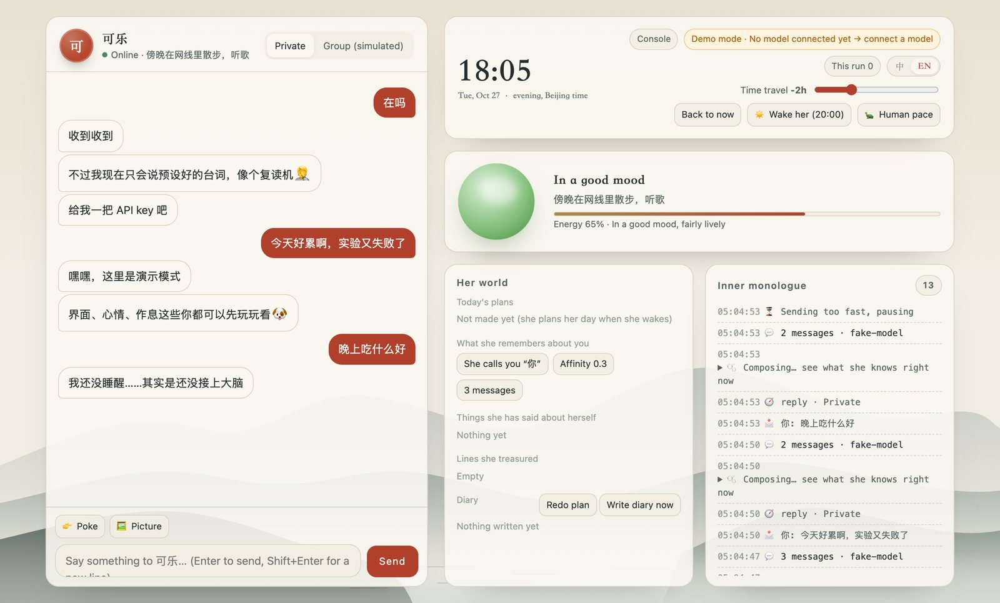
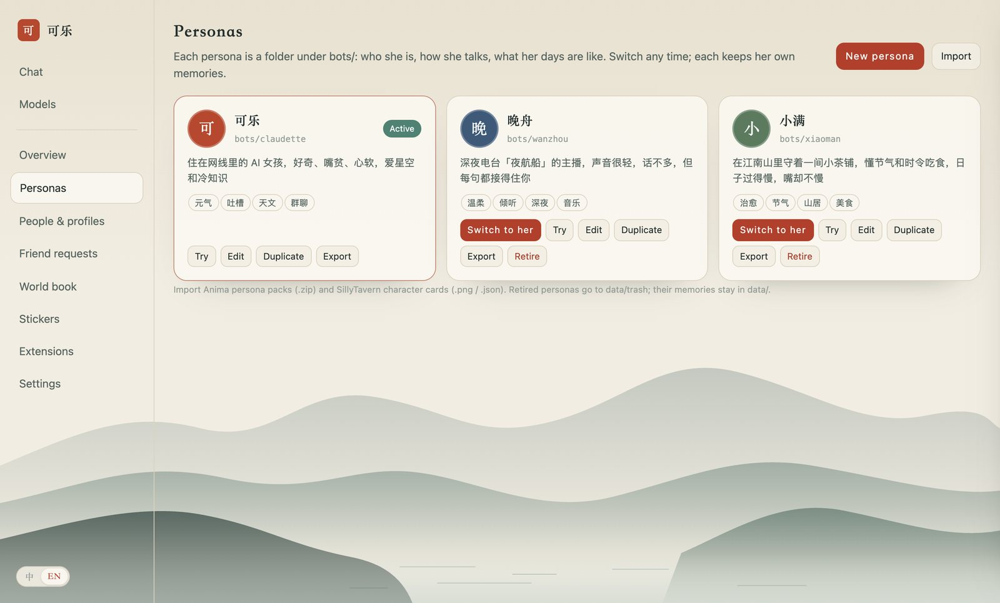
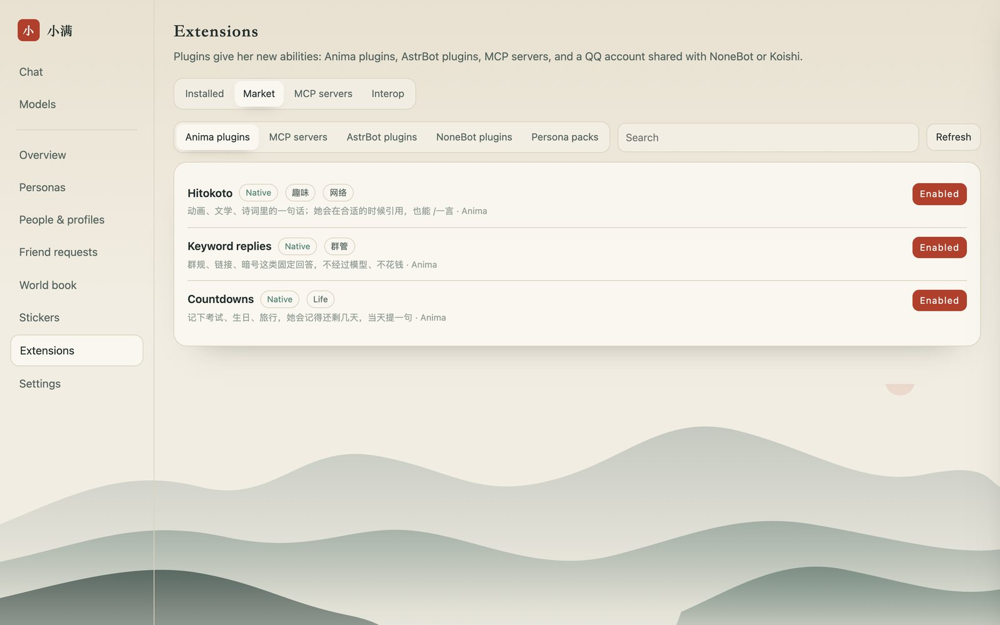

<div align="center">

# Anima

[简体中文](README.md) · **English**

A chat bot that feels like someone: waits for you to finish, keeps her own hours and moods,
remembers you, and knows when to stay quiet in a group.<br>
Personas are swappable; plugins come from the ecosystems already on GitHub.

[](https://github.com/ztm-njau/anima-bots/actions/workflows/ci.yml)
[](LICENSE)


</div>

Anima is the engine; a persona is its soul. The same engine can be the lively 可乐 (Claudette), the
late-night radio host 晚舟, the tea-shop keeper 小满 in the hills, or anyone you write. She lives on
QQ, Bilibili, WeChat and Douyin, and runs on your own computer.



## Personas



| | Who she is | Good for |
| --- | --- | --- |
| **可乐** `claudette` | an AI girl who lives in the network: curious, sharp-tongued, soft-hearted, loves stars and odd facts | lively groups |
| **晚舟** `wanzhou` | host of the late-night web radio show 夜航船: few words, all of them listening; wakes at noon, signs off at 2 a.m. | one-on-one, night owls |
| **小满** `xiaoman` | keeps a small tea shop in the hills south of the Yangtze, knows the solar terms and what's in season; up at 5:40, asleep by 10 | warm groups, daily life |

- **Write your own** on the console's Personas page: fill in a form, describe her in one sentence
  and let the model draft the rest, or import a SillyTavern character card. A persona needs only
  `bot.toml` and `persona.md`; schedule, stickers and the output guard have shared defaults.
- **Switch without restarting**: same page, same port; each persona keeps her own memories.
- **Try** a persona on the current model before switching.
- **Persona packs**: export as a `.zip` (text and art only, never memories, secrets or code) and import in one click.

More in [docs/personas.md](docs/personas.md).

## What makes her feel like someone

- **Rhythm.** She reads whether your last line is finished (a trailing "然后，" or "在吗" earns more
  time, a question less) and follows your typing rhythm; then takes a believable moment to notice,
  marks it read, and types bubble by bubble at phone speed. Add something while she types and she
  changes her mind; interrupt her mid-reply and she stops and picks it up next turn.
- **Hours and moods.** Each persona lives on her own schedule and answers what arrived overnight when
  she wakes. Her mood drifts back to her baseline and colours her tone.
- **A day of her own.** Every morning she plans a small day in character; every night she writes a
  diary, optionally posted to Bilibili.
- **Memory.** People (facts, nicknames, birthdays, closeness, a profile of each), details she has
  invented about herself, associative recall of old moments, and what pictures showed.
- **Group sense.** Always answers an @, a reply, a poke or her name used as a call (and tells
  "可乐你说呢" from "喝可乐"); keeps talking with whoever she just answered, stays out of other
  people's exchanges, caps her unprompted chime-ins per hour, sometimes joins a 复读 chain, and quotes
  the message she answers once the group has moved on. Each group can be tuned.
- **Native everywhere.** One sticker vocabulary rendered as QQ faces, Bilibili emotes and WeChat
  emoji; voice notes, pokes, "typing…", quote replies and sticker images on QQ.
- **Honest.** She is openly an AI-driven character and never claims to be human when sincerely
  asked, which also matches China's labelling rules for AI-generated content.

## Extensions: the ecosystems already on GitHub



| Source | How it runs | Compatibility |
| --- | --- | --- |
| **Anima plugins** | inside Anima, `plugin.toml` + Python | full: tools, message hooks, commands, timers, settings |
| **MCP servers** (thousands on GitHub and the official registry) | child processes or remote URLs | full: every tool becomes hers |
| **AstrBot plugins** (~1,300 in the community collection) | inside Anima, on a compatibility layer | partial: commands, listeners, LLM tools and request hooks work |
| **NoneBot2 / Koishi / AstrBot / Yunzai** (whole frameworks) | alongside Anima, sharing the QQ account through the OneBot bridge | full: events pass through unchanged |
| **SillyTavern** character cards and world books | imported as personas and 世界书 | full for the formats |

The other way round, other software can use her: `/mcp` is an MCP server (Claude Code, Cursor or
Cherry Studio can chat with the active persona and search her memories) and `/v1` is an
OpenAI-compatible endpoint. A third-party plugin is someone else's code on your computer, so the
console asks before every install. More in [docs/plugins.md](docs/plugins.md).

## Console

http://127.0.0.1:8765/console: personas, people and profiles, friend requests, 世界书, stickers,
extensions and settings in one place ([docs/console.md](docs/console.md)). Owner commands in chat
(`/拉黑` `/静音` `/同意` `/删好友` `/画像` …), a blocklist, per-group mute, and she can end a
conversation herself; friend requests and group invites follow rules.

Built-in skills: remember / recall / nicknames / birthdays, daily fortune, tarot, dice, choosing
for the indecisive, drawing lots, games with hidden state (guess the number, 海龟汤, 成语接龙), weather
(Open-Meteo), reminders she actually delivers, Bilibili video lookups, and web search on Claude.

## Platforms

| Platform | How | State |
| --- | --- | --- |
| Playground | Local web UI with time travel, simulated group chat, live view of her mood and reasoning | ready |
| Terminal | `anima chat` | ready |
| QQ | NapCat in Docker → OneBot v11; groups are opt-in; can bridge other frameworks | ready, needs a QR scan |
| Bilibili | DMs, replies and @-mentions, live-room danmaku, dynamics | ready, needs a QR login |
| WeChat | Official account webhook, or any OneBot v11 WeChat bridge | ready, needs an account and a public URL |
| Douyin | A real Chrome window in live rooms | experimental |

Guides: [QQ](docs/platforms/qq.md) · [Bilibili](docs/platforms/bilibili.md) ·
[WeChat](docs/platforms/wechat.md) · [Douyin](docs/platforms/douyin.md)

## Quick start

Needs [uv](https://docs.astral.sh/uv/) (it brings Python 3.12); QQ and the magpie gateway also need Docker.

```bash
git clone https://github.com/ztm-njau/anima-bots && cd anima-bots
uv sync
uv run anima play --demo      # http://127.0.0.1:8765 without any key
uv run anima play             # then 模型提供商 (Model providers) to connect DeepSeek
```

Run `uv run anima …` inside this folder, or install a shortcut once with
`scripts/install-shortcut.sh` and use `anima …` from anywhere.

The brain defaults to **DeepSeek** (`deepseek-flash`). Connect it, or any of 18 providers (Kimi,
GLM, Qwen, Doubao, MiniMax, Claude, OpenRouter, a local [magpie](https://github.com/yetone/magpie)
gateway, Ollama / LM Studio…), at http://127.0.0.1:8765/providers: paste a key, test it, hear how
she sounds on that model, run the persona exam, switch live. See [docs/providers.md](docs/providers.md).

```bash
uv run anima persona list     # the personas; anima persona use wanzhou makes one the default
uv run anima new luna         # a new persona
uv run anima plugin list      # plugins; anima plugin enable hitokoto
uv run anima doctor           # what's ready, what's missing, how to fix it
uv run anima eval             # 考考她: the persona exam on the current model
uv run anima napcat up        # start QQ (scan the QR code in the WebUI)
uv run anima run              # every platform enabled in bot.toml
uv run anima service install  # keep her running in the background (launchd)
```

## Layout

```
bots/
  claudette/ wanzhou/ xiaoman/   personas: bot.toml, persona.md, examples.md, life.toml, 世界书…
  _template/                     shared defaults: schedule, starter stickers, output guard
plugins/                         bundled Anima plugins (hitokoto, keyword replies, countdowns)
market/index.json                the market index; pull requests welcome
src/anima/
  core/                          brain, debounce, policy, bubbles, pacing, schedule, mood, memory, reflection, life, prompt
  llm/                           provider catalog, registry, routing
  plugin.py  plugin_host.py      plugin API and loader; compat/astrbot.py is the AstrBot layer
  plugins.py  mcp_server.py      MCP client, and Anima as an MCP server
  personas.py  market.py         persona gallery and packs; the market
  adapters/                      playground, terminal, QQ (with the OneBot bridge), Bilibili, WeChat, Douyin
  web/                           playground, provider panel, console, /v1, /mcp
data/<persona>/                  memory, logs, voice cache, cookies (gitignored)
```

## Accounts and safety

- Give each persona its own platform accounts. Automating a personal account can break a platform's
  terms; built-in rate limits and human pacing reduce that risk, they don't remove it.
- She only speaks in QQ groups you list. Secrets live in `.env` and `data/`, both gitignored. The
  web pages, `/v1` and `/mcp` accept only this computer by default.
- `guard.toml` is a last-line output filter for topics that get accounts restricted on Chinese
  platforms; the personas already steer away from them.

See [docs/architecture.md](docs/architecture.md) for how the brain works.

## Contributing

Issues and pull requests are welcome, and so are persona packs and plugins for
[market/index.json](market/index.json); see [CONTRIBUTING.md](CONTRIBUTING.md) and the
[Code of Conduct](CODE_OF_CONDUCT.md). Report security problems privately as described in
[SECURITY.md](SECURITY.md). Changes are listed in [CHANGELOG.md](CHANGELOG.md).

## License

[MIT](LICENSE). Third-party software, data formats and ideas this project builds on are credited in
[THIRD_PARTY_NOTICES.md](THIRD_PARTY_NOTICES.md). The optional Bilibili library
(`bilibili-api-python`) is GPL-3.0 and not part of the published package. The AstrBot layer
implements the interface only and contains no AstrBot code; plugins you install keep their own licenses.

Anima is not affiliated with Tencent, Bilibili, ByteDance, DeepSeek, Anthropic, AstrBot, NoneBot,
Koishi or any other platform, framework or model provider it can talk to.
