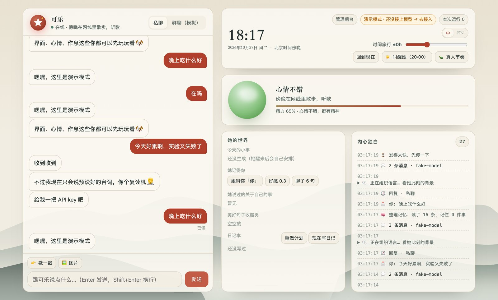

# Anima · 可乐

A soul engine for human-like social bots, and its first resident: **Claudette (可乐)**, a curious,
sharp-tongued, warm-hearted girl who lives on the internet and hangs out on QQ, Bilibili, WeChat
and Douyin.



## What makes her feel like someone

- **Rhythm.** She waits for you to finish typing (three quick messages become one batch), takes
  a believable moment to notice, marks it read, then types bubble by bubble at phone speed.
- **A life.** She runs on Beijing time: up around 08:30, online classes in the morning, most
  chatty in the evening, asleep after midnight (later on weekends, with the odd sleepless night).
  Messages sent while she sleeps are answered when she wakes, with a groggy "刚醒".
- **A day of her own.** Every morning she plans a small day (a theme, a few events, a song, what
  her electronic cat Bug got up to). Every night she writes a diary, optionally posted to Bilibili.
- **Mood.** A small emotional state that drifts back to her cheerful baseline and colours her tone.
- **Memory.** People (facts, nicknames, birthdays, how close she feels), her own invented details
  (so her stories stay consistent), and a collection of beautiful sentences strangers said to her.
  A background reflection pass distils each conversation into memories.
- **Group sense.** Always answers an @, her name, a reply, or a poke. Otherwise she chimes in now
  and then, more when the topic is stars, cats, films or late-night food, less when she has been
  talking a lot. Knowing when to stay quiet is most of the trick.
- **Native everywhere.** One sticker vocabulary rendered as QQ faces, Bilibili emotes and WeChat
  emoji; voice notes on QQ (neural TTS); pokes back when poked; "对方正在输入…"; quote replies.
- **Honest.** She is openly an AI-driven character and never claims to be human when sincerely
  asked, which also matches China's labelling rules for AI-generated content.

## Owner, relationships, 世界书, 表情包, plugins

- **管理后台** at http://127.0.0.1:8765/console: people and 用户画像, friend requests, 世界书,
  表情包, MCP plugins and every setting in one place ([docs/console.md](docs/console.md)).
- **Owner commands** in chat (`/拉黑` `/静音` `/同意` `/删好友` `/画像` …), a blocklist, per-group
  mute, and she can end a conversation herself when someone crosses a line.
- **Friend requests and group invites** by rule: accept, accept people she knows or who know the
  password, ask the owner, or ignore; she greets new friends.
- **世界书** that imports SillyTavern world books and character cards; a card can become a new bot.
- **表情包**: a starter pack drawn for her, stickers she collects from chats (tagged by vision), uploads.
- **Memory**: image descriptions kept in history, associative recall of related facts and old
  moments, a profile per person kept current.
- **Plugins**: any MCP server (Claude Desktop config format) becomes her tools.
- **She is a model too**: an OpenAI-compatible endpoint lets AstrBot, NoneBot, Koishi or SillyTavern
  use her whole brain ([docs/integrations.md](docs/integrations.md)).

## Skills

Tools she reaches for mid-conversation, in her own voice: remember / recall / nicknames /
birthdays, daily fortune (stable per person per day), tarot, dice, choosing for the indecisive,
"可乐签", games with hidden state (guess the number, 海龟汤 turtle soup, 成语接龙), weather
(Open-Meteo), reminders she actually delivers, Bilibili video lookups (title, stats, AI summary)
for links people share, her own day and treasure box, and Claude's web search for fresh facts.

## Platforms

| Platform | How | State |
| --- | --- | --- |
| Playground | Local web UI with time travel, simulated group chat, live view of her mood and reasoning | ready |
| Terminal | `anima chat` | ready |
| QQ | NapCat in Docker (OrbStack) → OneBot v11 WebSocket. Groups are opt-in. | ready, needs a QQ account scan |
| Bilibili | DMs, replies and @-mentions, live-room danmaku, dynamics | ready, needs a QR login |
| WeChat | Official account (公众号) webhook; or any OneBot v11 WeChat bridge | ready, needs an account and a public URL |
| Douyin | A real Chrome window in live rooms | experimental |

Step-by-step guides: [QQ](docs/platforms/qq.md) · [Bilibili](docs/platforms/bilibili.md) ·
[WeChat](docs/platforms/wechat.md) · [Douyin](docs/platforms/douyin.md)

## Quick start

```bash
uv run anima play             # http://127.0.0.1:8765, then 模型提供商 to connect DeepSeek
```

Run `uv run anima …` inside this folder, or install a shortcut once with
`scripts/install-shortcut.sh` and use `anima …` from anywhere.

Her brain defaults to **DeepSeek** (`deepseek-flash`). Connect it, or any of 18 providers
(Kimi, GLM, Qwen, Doubao, MiniMax, Claude, OpenRouter, a local [magpie](https://github.com/yetone/magpie)
gateway, Ollama / LM Studio…), in the
**模型提供商** panel at http://127.0.0.1:8765/providers: paste a key, test it, hear how she
sounds on that model, give her a 12-scenario exam, and switch live. A `DEEPSEEK_API_KEY` in `.env`
works too. Without any key she runs in demo mode (canned lines). See [docs/providers.md](docs/providers.md).

```bash
uv run anima doctor           # what's ready, what's missing, how to fix it
uv run anima providers list   # model providers and what she's running on
uv run anima eval             # 考考她: the persona exam on the current model
uv run anima chat             # talk in the terminal
uv run anima napcat up        # start QQ (scan the QR code in the WebUI)
uv run anima login bilibili   # QR login for Bilibili
uv run anima run              # every platform enabled in bot.toml
uv run anima memory           # who she knows and what she remembers
uv run anima diary            # read her diary
uv run anima service install  # keep her running in the background (launchd)
```

## Layout

```
bots/
  claudette/         persona.md, examples.md, bot.toml, life.toml, stickers.toml, guard.toml
  _template/         `uv run anima new <name>` copies this to start another bot
src/anima/
  core/              brain, policy, humanizer, schedule, mood, memory, reflection, life, prompt
  llm/               provider catalog + registry + routing; Claude (Anthropic SDK), OpenAI-compatible, fake
  evals.py           考考她: persona exam
  skills/            the tools above; bots can add their own in bots/<name>/skills/*.py
  adapters/          playground, console, onebot (QQ), bilibili, wechat, douyin
  web/               playground UI, 模型提供商 panel, webhooks
infra/napcat/        Docker compose + OneBot config template for QQ
data/<bot>/          memory.db, logs, voice cache, cookies and browser profiles (gitignored)
```

A bot is a folder: everything that makes Claudette *Claudette* is text you can edit. Another
character is `uv run anima new luna`, a persona, and a `bot.toml`.

## Accounts and safety

- Give each bot its own platform accounts. Automating a personal account can break a platform's
  terms and get it restricted; built-in rate limits and human pacing reduce that risk, they don't
  remove it.
- She only speaks in QQ groups you list. Secrets live in `.env` and `data/`, both gitignored.
- `guard.toml` is a last-line output filter for topics that get accounts restricted on Chinese
  platforms; the persona already steers away from them.

See [docs/architecture.md](docs/architecture.md) for how the brain works.
