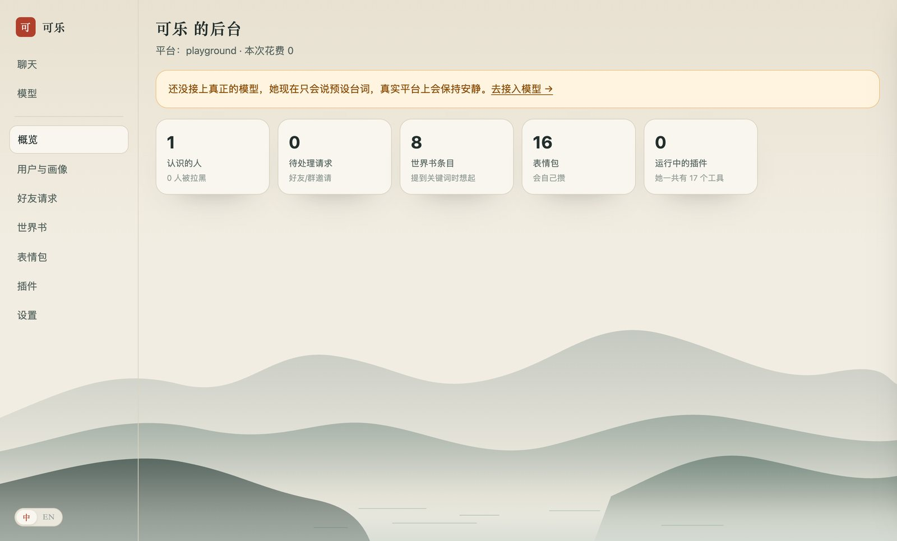
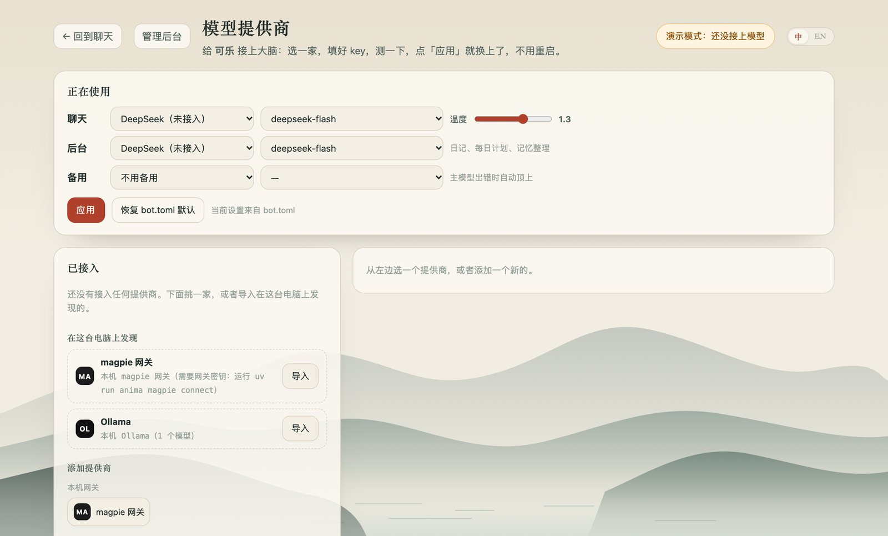

<div align="center">

# Anima · 可乐

**简体中文** · [English](README.en.md)

[](https://github.com/ztm-njau/anima-bots/actions/workflows/ci.yml)
[](LICENSE)


</div>

一个让社交机器人"像个人"的灵魂引擎，以及住进来的第一位居民：**可乐（Claudette）**。
她好奇、嘴有点毒、心很软，住在网上，平时混迹 QQ、B 站、微信和抖音。


## 她为什么像一个人

- **节奏。** 等你把话说完（连发三条会被合成一批），过一会儿才"看到"，标为已读，再一个气泡一个气泡地按手机打字的速度回。
- **作息。** 她活在北京时间：八点半左右起床，上午上网课，晚上最能聊，过了午夜睡觉（周末更晚，偶尔失眠）。
  睡着时收到的消息，醒了才回，开头可能是一句迷糊的"刚醒"。
- **自己的一天。** 每天早上给自己排一个小日程（主题、几件小事、一首歌、电子猫 Bug 又干了什么），每晚写日记，可选发到 B 站动态。
- **心情。** 一个会慢慢回到开朗基线的情绪状态，影响她说话的语气。
- **记忆。** 记得每个人（事实、昵称、生日、亲近程度），记得自己编过的细节（故事前后一致），还收藏陌生人对她说过的好句子。
  后台的反思会把每段对话提炼成记忆。
- **群聊分寸。** 被 @、被叫名字、被回复、被戳一定回；其他时候偶尔插一句，聊到星星、猫、电影、夜宵会多说两句，说多了会收着点。会闭嘴是最难的部分。
- **入乡随俗。** 一套表情词汇，在 QQ 是小黄脸、在 B 站是表情、在微信是 emoji；QQ 上能发语音（神经网络 TTS），被戳会戳回去，有"对方正在输入…"，会引用回复。
- **诚实。** 她是公开的 AI 驱动角色，被认真问到时从不冒充真人，这也符合国内对 AI 生成内容的标识要求。

## 主人、关系、世界书、表情包、插件



- **管理后台** http://127.0.0.1:8765/console ：用户与画像、好友请求、世界书、表情包、MCP 插件和全部设置都在一处（[docs/console.md](docs/console.md)）。
- **主人命令**（`/拉黑` `/静音` `/同意` `/删好友` `/画像` …）、黑名单、按群静音；有人越界时她可以自己结束对话。
- **好友请求和群邀请按规则处理**：全部同意、只同意认识的人或答对暗号的人、问主人、忽略；新朋友会收到她的招呼。
- **世界书**：可导入 SillyTavern 世界书和角色卡，一张角色卡能直接变成一个新 bot。
- **表情包**：一套为她原创绘制的起手包，加上她从聊天里攒的（用视觉模型打标签）和你上传的。
- **记忆**：图片描述会留在历史里，联想召回相关的事实和旧时刻，每个人一份随时更新的画像。
- **插件**：任何 MCP 服务器（Claude Desktop 的配置格式）都能变成她的工具。
- **她自己也是个模型**：OpenAI 兼容接口让 AstrBot、NoneBot、Koishi、SillyTavern 直接用她的整个大脑（[docs/integrations.md](docs/integrations.md)）。

## 技能

聊天中途她会用自己的语气调用这些工具：记住 / 想起 / 昵称 / 生日，今日运势（同一个人同一天结果固定），塔罗，骰子，
替选择困难的人做决定，"可乐签"，带隐藏状态的小游戏（猜数字、海龟汤、成语接龙），天气（Open-Meteo），真的会按时提醒你的提醒，
别人分享 B 站链接时查视频（标题、数据、AI 总结），她自己的一天和百宝箱，以及用 Claude 的联网搜索查新鲜事。

## 平台

| 平台 | 方式 | 状态 |
| --- | --- | --- |
| 测试台 | 本地网页：时间旅行、模拟群聊、实时看她的心情和思路 | 可用 |
| 终端 | `anima chat` | 可用 |
| QQ | Docker 里的 NapCat → OneBot v11 WebSocket，群聊需逐个开启 | 可用，需扫码登录 QQ |
| B 站 | 私信、评论回复和 @、直播间弹幕、动态 | 可用，需扫码登录 |
| 微信 | 公众号 webhook，或任意 OneBot v11 微信桥 | 可用，需账号和公网地址 |
| 抖音 | 用真实的 Chrome 窗口进直播间 | 实验性 |

分步指南：[QQ](docs/platforms/qq.md) · [B 站](docs/platforms/bilibili.md) · [微信](docs/platforms/wechat.md) · [抖音](docs/platforms/douyin.md)

## 快速开始

需要 [uv](https://docs.astral.sh/uv/)（它会带上 Python 3.12）；QQ 和 magpie 网关另需 Docker。

```bash
git clone https://github.com/ztm-njau/anima-bots && cd anima-bots
uv sync
uv run anima play --demo      # 不需要任何 key，打开 http://127.0.0.1:8765
uv run anima play             # 然后在「模型提供商」里接入 DeepSeek
```

在项目目录里用 `uv run anima …`；或者运行一次 `scripts/install-shortcut.sh`，之后在任何地方直接用 `anima …`。

她的大脑默认是 **DeepSeek**（`deepseek-flash`）。在 http://127.0.0.1:8765/providers 的**模型提供商**面板里接入它，
或者 18 家里的任意一家（Kimi、智谱 GLM、通义千问、豆包、MiniMax、Claude、OpenRouter、本地的
[magpie](https://github.com/yetone/magpie) 网关、Ollama / LM Studio…）：粘贴 key、测试连接、听听她在这个模型上的样子、
做一套 12 题的人设考试、实时切换。也可以把 `DEEPSEEK_API_KEY` 写进 `.env`。没有 key 时她在演示模式下只说预设台词。
详见 [docs/providers.md](docs/providers.md)。



```bash
uv run anima doctor           # 哪些就绪、缺什么、怎么补
uv run anima providers list   # 模型提供商，以及她正在用哪个
uv run anima eval             # 考考她：在当前模型上跑人设考试
uv run anima magpie up        # 在 Docker 里启动 magpie 网关并接上她
uv run anima chat             # 在终端里聊
uv run anima napcat up        # 启动 QQ（在 WebUI 里扫码）
uv run anima login bilibili   # B 站扫码登录
uv run anima run              # 启动 bot.toml 里开启的所有平台
uv run anima memory           # 她认识谁、记得什么
uv run anima diary            # 看她的日记
uv run anima service install  # 让她在后台常驻（macOS launchd）
```

## 目录结构

```
bots/
  claudette/         persona.md, examples.md, bot.toml, life.toml, stickers.toml, guard.toml
  _template/         `uv run anima new <name>` 从这里复制出新 bot
src/anima/
  core/              大脑、发言策略、拟人节奏、作息、心情、记忆、反思、生活、提示词
  llm/               提供商目录 + 注册表 + 路由；Claude（Anthropic SDK）、OpenAI 兼容、离线假模型
  evals.py           考考她：人设考试
  skills/            上面的技能；bot 也可以在 bots/<name>/skills/*.py 里加自己的
  adapters/          测试台、后台、onebot（QQ）、bilibili、wechat、douyin
  web/               测试台、模型提供商面板、管理后台、webhook、/v1 接口
infra/               NapCat 与 magpie 的 Docker 配置
data/<bot>/          memory.db、日志、语音缓存、cookie 和浏览器配置（不进 git）
```

一个 bot 就是一个文件夹：让可乐成为可乐的一切，都是你能直接改的文本。另一个角色只需要 `uv run anima new luna`、一份人设和一个 `bot.toml`。

## 账号与安全

- 给每个 bot 单独的平台账号。自动化个人账号可能违反平台条款并被限制；内置的频率限制和拟人节奏能降低风险，但不能消除。
- 她只在你列出的 QQ 群里说话。密钥只放在 `.env` 和 `data/`，都不进 git。网页只监听本机。
- `guard.toml` 是最后一道输出过滤，拦下在国内平台容易导致封号的话题；人设本身已经会避开它们。

大脑如何工作见 [docs/architecture.md](docs/architecture.md)。

## 参与贡献

欢迎 issue 和 PR，请先看 [CONTRIBUTING.md](CONTRIBUTING.md) 和 [行为准则](CODE_OF_CONDUCT.md)。
安全问题请按 [SECURITY.md](SECURITY.md) 私下报告。更新记录见 [CHANGELOG.md](CHANGELOG.md)。

## 许可证

[MIT](LICENSE)。本项目用到的第三方软件、数据格式和借鉴的思路列在 [THIRD_PARTY_NOTICES.md](THIRD_PARTY_NOTICES.md)。
可选的 B 站库 `bilibili-api-python` 是 GPL-3.0，不包含在发布的包里；不装它，除 B 站外一切照常。

Anima 与腾讯、哔哩哔哩、字节跳动、DeepSeek、Anthropic 以及它能对接的任何平台或模型提供商均无关联。
