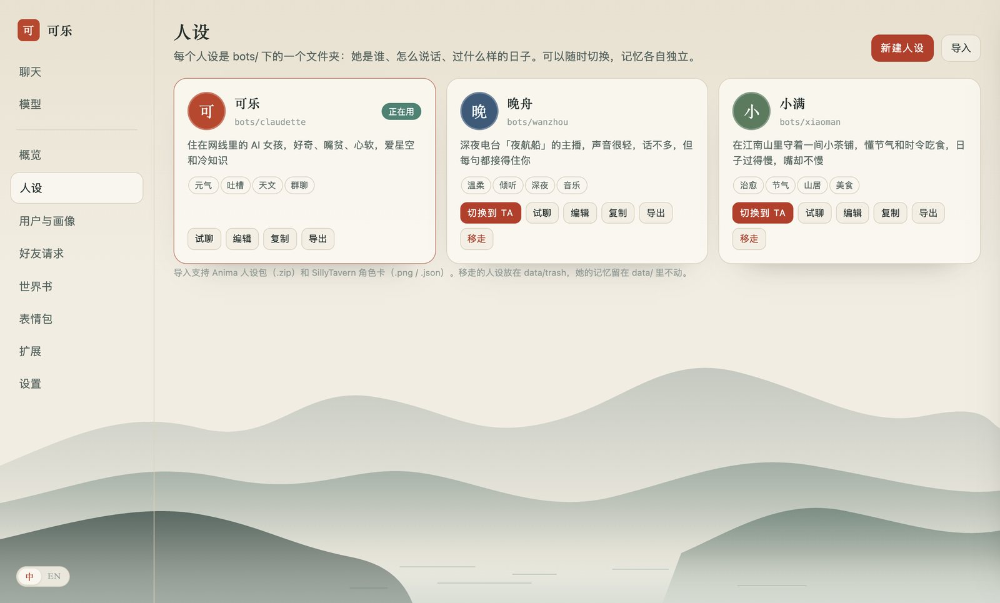
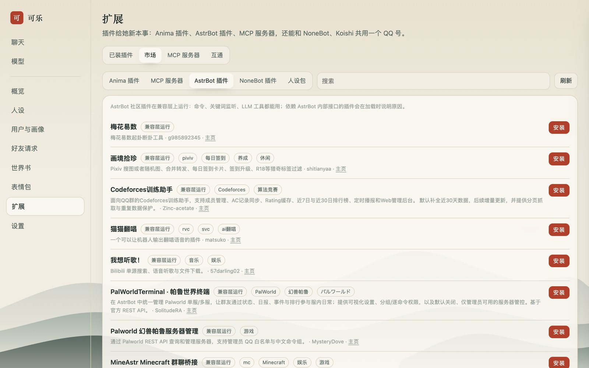

<div align="center">

# Anima

**简体中文** · [English](README.en.md)

让聊天机器人像一个人：会等你说完、有自己的作息和心情、记得你、懂群里的分寸。<br>
人设随你换，插件接得上 GitHub 上现成的生态。

[](https://github.com/ztm-njau/anima-bots/actions/workflows/ci.yml)
[](LICENSE)


</div>

Anima 是一个引擎，人设是她的灵魂。同一套引擎可以是元气满满的「可乐」、深夜电台的「晚舟」、山里茶铺的「小满」，
也可以是你自己写的任何人。她住在 QQ、B 站、微信和抖音，在你的电脑上运行。


## 人设



| | 她是谁 | 适合 |
| --- | --- | --- |
| **可乐** `claudette` | 住在网线里的 AI 女孩，好奇、嘴贫、心软，爱星空和冷知识 | 热闹的群 |
| **晚舟** `wanzhou` | 深夜电台「夜航船」的主播，话不多，但每句都接得住你；中午才醒，凌晨两点下播 | 私聊、夜猫子 |
| **小满** `xiaoman` | 在江南山里守着一间小茶铺，懂节气和时令吃食；五点四十起床，十点就睡 | 温和的群、日常 |

- **自己写一个**：在后台「人设」页填表，或者写一句话让模型起草完整设定，或者导入 SillyTavern 角色卡。
  一个人设最少只要 `bot.toml` 和 `persona.md`，作息、表情包、输出过滤都有共享默认值。
- **一键切换，不用重启**：同一个网页、同一个端口，每个人设的记忆各自独立。
- **试聊**：切换之前，先用当前模型听听她怎么说话。
- **人设包**：导出成 `.zip` 分享（只有文字和图片，不含记忆、密钥和代码），别人一键导入。

详见 [docs/personas.md](docs/personas.md)。

## 她为什么像一个人

- **节奏。** 看你最后一句有没有说完（「然后，」「在吗」会多等一会，问句会早点回），跟着你的打字节奏等；过一会儿才"看到"，
  标为已读，再一个气泡一个气泡地按手机打字的速度回。她打字时你补了一句，她会改口；发到一半被打断就停下，下一轮接上。
- **作息与心情。** 每个人设活在自己的作息里，睡着时收到的消息醒了才回。心情会慢慢回到她的基线，影响语气。
- **自己的一天。** 每天早上按人设给自己排一个小日程，每晚写日记（可选发到 B 站动态）。
- **记忆。** 记得每个人（事实、昵称、生日、亲近程度、用户画像），记得自己编过的细节，联想召回相关的往事；看过的图会记住内容。
- **群聊分寸。** 被 @、被回复、被戳、被叫名字一定回（分得清「可乐你说呢」和「喝可乐」）；会接着跟刚聊过的人说，
  别人互相 @ 时不插嘴，每小时主动插话有上限，偶尔跟着复读，话题过去了会引用她回的那条。每个群可以单独调。
- **入乡随俗。** 一套表情词汇对应 QQ 小黄脸、B 站表情、微信 emoji；QQ 上能发语音、戳一戳、"对方正在输入…"、引用回复、发表情包图。
- **诚实。** 她是公开的 AI 驱动角色，被认真问到时从不冒充真人，这也符合国内对 AI 生成内容的标识要求。

## 扩展：接上 GitHub 上现成的生态



| 来源 | 怎么运行 | 兼容程度 |
| --- | --- | --- |
| **Anima 插件** | 在 Anima 里，`plugin.toml` + Python | 完整：工具、消息钩子、命令、定时任务、设置项 |
| **MCP 服务器**（GitHub 上和官方注册表里成千上万个） | 子进程或远程地址 | 完整：每个工具都变成她的 |
| **AstrBot 插件**（社区约 1300 个） | 在 Anima 里，跑在兼容层上 | 部分：命令、关键词监听、LLM 工具、请求钩子都能用 |
| **NoneBot2 / Koishi / AstrBot / 云崽**（整个框架） | 在旁边运行，通过 OneBot 桥接共用 QQ 号 | 完整：消息原样转发，插件不用改 |
| **SillyTavern** 角色卡、世界书 | 导入成人设和世界书 | 格式完整兼容 |

反过来，她也能被别的软件用：`/mcp` 是一个 MCP 服务器（Claude Code、Cursor、Cherry Studio 可以直接和当前人设聊天、查她的记忆），
`/v1` 是 OpenAI 兼容接口。安装第三方插件就是在你电脑上运行别人的代码，后台每次安装都会先问你。详见 [docs/plugins.md](docs/plugins.md)。

## 管理后台

http://127.0.0.1:8765/console ：人设、用户与画像、好友请求、世界书、表情包、扩展、设置都在一处（[docs/console.md](docs/console.md)）。
另有主人命令（`/拉黑` `/静音` `/同意` `/删好友` `/画像` …）、黑名单、按群静音，有人越界时她可以自己结束对话；
好友请求和群邀请按规则处理。

内置技能：记住 / 想起 / 昵称 / 生日、今日运势、塔罗、骰子、帮你做选择、抽签、带隐藏状态的小游戏（猜数字、海龟汤、成语接龙）、
天气（Open-Meteo）、真的会按时提醒的提醒、B 站视频查询，以及（用 Claude 时）联网搜索。

## 平台

| 平台 | 方式 | 状态 |
| --- | --- | --- |
| 测试台 | 本地网页：时间旅行、模拟群聊、实时看她的心情和思路 | 可用 |
| 终端 | `anima chat` | 可用 |
| QQ | Docker 里的 NapCat → OneBot v11，群聊需逐个开启；可桥接其他框架 | 可用，需扫码登录 |
| B 站 | 私信、评论回复和 @、直播间弹幕、动态 | 可用，需扫码登录 |
| 微信 | 公众号 webhook，或任意 OneBot v11 微信桥 | 可用，需账号和公网地址 |
| 抖音 | 用真实的 Chrome 窗口进直播间 | 实验性 |

分步指南：[QQ](docs/platforms/qq.md) · [B 站](docs/platforms/bilibili.md) · [微信](docs/platforms/wechat.md) · [抖音](docs/platforms/douyin.md)

## 快速开始

需要 [uv](https://docs.astral.sh/uv/)（它会带上 Python 3.12）；QQ 和 magpie 网关另需 Docker。

```bash
git clone https://github.com/ztm-njau/anima-bots && cd anima-bots
uv sync
uv run anima play --demo      # 不需要任何 key，打开 http://127.0.0.1:8765
uv run anima play             # 然后在「模型提供商」里接入 DeepSeek
```

在项目目录里用 `uv run anima …`；或者运行一次 `scripts/install-shortcut.sh`，之后在任何地方直接用 `anima …`。

大脑默认是 **DeepSeek**（`deepseek-flash`）。在 http://127.0.0.1:8765/providers 接入它，或者 18 家里的任意一家
（Kimi、智谱 GLM、通义千问、豆包、MiniMax、Claude、OpenRouter、本地的 [magpie](https://github.com/yetone/magpie) 网关、Ollama / LM Studio…）：
粘贴 key、测试连接、听听她在这个模型上的样子、做一套人设考试、实时切换。详见 [docs/providers.md](docs/providers.md)。

```bash
uv run anima persona list     # 有哪些人设；anima persona use wanzhou 设为默认
uv run anima new luna         # 新建一个人设
uv run anima plugin list      # 插件；anima plugin enable hitokoto
uv run anima doctor           # 哪些就绪、缺什么、怎么补
uv run anima eval             # 考考她：在当前模型上跑人设考试
uv run anima napcat up        # 启动 QQ（在 WebUI 里扫码）
uv run anima run              # 启动 bot.toml 里开启的所有平台
uv run anima service install  # 让她在后台常驻（macOS launchd）
```

## 目录结构

```
bots/
  claudette/ wanzhou/ xiaoman/   人设：bot.toml、persona.md、examples.md、life.toml、世界书……
  _template/                     共享默认值：作息、表情包起手包、输出过滤；新人设从这里开始
plugins/                         自带的 Anima 插件（一言、关键词回复、倒数日）
market/index.json                插件市场索引，欢迎提 PR
src/anima/
  core/                          大脑、防抖、发言策略、分段、拟人节奏、作息、心情、记忆、反思、生活、提示词
  llm/                           模型提供商目录、注册表、路由
  plugin.py  plugin_host.py      插件 API 与加载；compat/astrbot.py 是 AstrBot 兼容层
  plugins.py  mcp_server.py      MCP 客户端，以及她自己作为 MCP 服务器
  personas.py  market.py         人设库与人设包；插件市场
  adapters/                      测试台、终端、QQ（含 OneBot 桥接）、B 站、微信、抖音
  web/                           测试台、模型提供商面板、管理后台、/v1、/mcp
data/<人设>/                     记忆、日志、语音缓存、cookie（不进 git）
```

## 账号与安全

- 给每个人设单独的平台账号。自动化个人账号可能违反平台条款并被限制；内置的频率限制和拟人节奏能降低风险，但不能消除。
- 她只在你列出的 QQ 群里说话。密钥只放在 `.env` 和 `data/`，都不进 git。网页、`/v1` 和 `/mcp` 默认只接受本机访问。
- `guard.toml` 是最后一道输出过滤，拦下在国内平台容易导致封号的话题；人设本身已经会避开它们。

大脑如何工作见 [docs/architecture.md](docs/architecture.md)。

## 参与贡献

欢迎 issue 和 PR，新的人设包和插件也欢迎加进 [market/index.json](market/index.json)。请先看 [CONTRIBUTING.md](CONTRIBUTING.md)
和 [行为准则](CODE_OF_CONDUCT.md)。安全问题请按 [SECURITY.md](SECURITY.md) 私下报告。更新记录见 [CHANGELOG.md](CHANGELOG.md)。

## 许可证

[MIT](LICENSE)。用到的第三方软件、数据格式和借鉴的思路列在 [THIRD_PARTY_NOTICES.md](THIRD_PARTY_NOTICES.md)。
可选的 B 站库 `bilibili-api-python` 是 GPL-3.0，不包含在发布的包里。AstrBot 兼容层只实现了接口，不含 AstrBot 的代码；
你安装的第三方插件遵循它们各自的许可证。

Anima 与腾讯、哔哩哔哩、字节跳动、DeepSeek、Anthropic、AstrBot、NoneBot、Koishi 以及它能对接的任何平台、框架或模型提供商均无关联。
