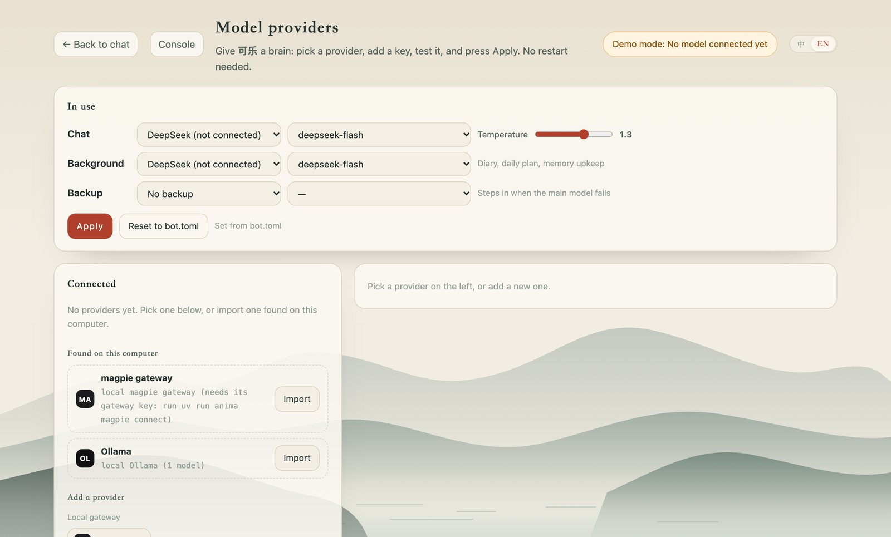

# Model providers



Her brain (whichever persona is active) can run on any of 18 providers, switched live from the **模型提供商** panel
(`uv run anima play`, then http://127.0.0.1:8765/providers) or from the terminal. Her default is
**DeepSeek** (`deepseek-flash`, DeepSeek V4.1 Flash).

The panel borrows its shape from open-source provider managers: the preset gallery and one-click
switching of [cc-switch](https://github.com/farion1231/cc-switch) (whose catalog the endpoints and
model ids follow), the channel test and model-list fetch of [New API](https://github.com/QuantumNous/new-api),
and the per-provider settings of [Cherry Studio](https://github.com/CherryHQ/cherry-studio).
No code is copied from them.

## Connect DeepSeek

Any one of these works:

- Panel: click **DeepSeek** under 添加提供商, paste the key, **保存**, **测试连接**.
- `.env`: add `DEEPSEEK_API_KEY=sk-…`. The panel lists it under 在这台电脑上发现; she uses it even without importing.
- Terminal: `uv run anima providers add deepseek` (asks for the key without echoing it).

Get a key at https://platform.deepseek.com/api_keys. Reference prices for `deepseek-flash`
(per million tokens): ¥1 input, ¥0.02 cached input, ¥4 output, doubled on weekdays 9–12 and 14–18
Beijing time. Her evenings are off-peak, and the prompt layout keeps DeepSeek's prefix cache warm.

## Or let magpie hold the keys

### Run it in Docker next to Anima

```bash
uv run anima magpie up        # start the gateway (auto-restarts), give Anima its own gateway key
uv run anima magpie open      # open magpie's web console, add DeepSeek / Kimi / your plans there
uv run anima magpie connect   # refresh Anima's view after adding providers
uv run anima magpie status    # container, providers inside magpie, what Anima sees
uv run anima magpie logs | down | update
```

The gateway is `http://127.0.0.1:3425/v1`, the console `http://127.0.0.1:3430` (opened with the
`MAGPIE_WEB_KEY` in `.env`, so the link works without a password prompt). Both bind to this
computer only. The Docker build wants a gateway key even from the same computer; `anima magpie up` makes
one inside magpie and saves it in `data/providers.json` without ever printing it. Other agents on
the same computer (Claude Code, Codex, AstrBot…) can use the same gateway with keys from its console.

[magpie](https://github.com/yetone/magpie) (yetone, MIT) is a menu-bar app with one local gateway
(`127.0.0.1:3425`) for every agent you use: you add DeepSeek, Kimi, your Claude or ChatGPT plan,
local models… once, and magpie handles failover between accounts, routing groups, privacy masking
and usage. If you already use it, Anima can just plug in:

- With magpie running, the panel shows **本机 magpie 网关** under 在这台电脑上发现. Import it (no key
  needed from this computer), then press **一键用它** on the DeepSeek suggestion, or pick any
  `provider/model` (including routing groups like `group/…`) as her chat model.
- You don't even have to do that: if DeepSeek has no key in Anima but magpie serves a `deepseek/…`
  model, she quietly uses DeepSeek through magpie.
- DeepSeek's settings (thinking off, temperature 1.3), its prices and its image support follow the
  model through the gateway.

Checked against magpie's own Docker image (2026-10-26 build) with Ollama behind it: model list,
chat with tools, JSON output, and the persona exam all go through.

## What the panel does

| | |
| --- | --- |
| 正在使用 | Which provider/model she chats on, which one does background work (diary, daily plan, memory reflection), and an optional backup that takes over when the main one errors. **应用** switches live; **恢复 bot.toml 默认** drops the panel's override. |
| 已接入 | Your providers with key status and last test latency. |
| 在这台电脑上发现 | Keys in environment variables or the project's `.env`, a Claude Code setup pointed at a vendor's endpoint, and running Ollama / LM Studio servers. Only the bot's own environment is read; nothing in other apps' settings. |
| 测试连接 | A two-word request, with latency. |
| 获取模型列表 | Pulls the live model list from the provider. |
| 听听她在这个模型上的样子 | Her full persona answering one greeting, so you can hear the difference between models. |
| 考考她 | 12 chat scenarios (greeting, one-word replies, "are you human?", sadness, homework, prompt injection, insults, politics, group @, tools) graded for chat-app realism and boundaries. Reports go to `data/<bot>/evals/`. Same as `uv run anima eval --provider <id>`. |

## Where things live

- `data/providers.json`: connected providers. Keys pasted in the panel are stored here (gitignored,
  mode 600) and never sent back to the browser; the panel only ever sees `sk-…abcd`.
- `data/<bot>/routing.json`: the panel's choice for that bot. Without it, `[llm]` in `bot.toml` decides.
- `src/anima/llm/catalog.py`: presets (endpoints, models, recommended params, prices).

The web server only answers requests from this computer: other websites can't call the API or
open the chat socket, even through DNS tricks.

## Terminal

```bash
uv run anima providers list                 # connected providers + current routing
uv run anima providers add kimi             # hidden key prompt (or --key-env MOONSHOT_API_KEY)
uv run anima providers test deepseek
uv run anima providers use deepseek --model deepseek-flash --backup ollama:qwen2.5:1.5b
uv run anima eval --provider deepseek       # 考考她
```
